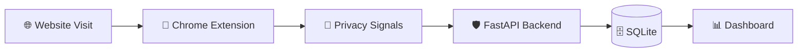

# 🌐 Invisible to Visible

<p align="center">
  <strong>Making invisible digital activity visible.</strong>
</p>

<p align="center">
  A privacy-awareness platform that helps users understand what happens behind the scenes when they browse the web.
</p>

<p align="center">
  
  
  
  
</p>

---

## ✨ About the Project

**Invisible to Visible (PriviLens)** is a privacy-awareness project designed to make website visits and privacy-related activity more transparent through a browser extension, a local backend, and a dashboard.

Modern websites interact with browsers through network requests, cookies, scripts, and browser APIs. Some of these interactions are associated with tracking and fingerprinting techniques, yet much of this activity remains invisible to everyday users.

Invisible to Visible aims to bring selected aspects of this activity into a simple, understandable, and user-controlled interface.

> 🔍 **The goal:** Turn invisible digital activity into visible, understandable information.

---

## 🚀 Current Status

<details>
<summary><strong>Milestone overview</strong></summary>

| Milestone | Status |
|---|---|
| M0 – Repository cleanup | ✅ Completed |
| M1 – Contract and application skeleton | ✅ Completed |
| M2a – Tracker detection | ✅ Completed |
| M2b – Cookie and referrer signals | ✅ Completed |
| M2c – In-page privacy signal collection | ✅ Completed |
| M3a – Early-request attribution | ✅ Completed |
| M3b – Backend store, migrations and retention | ✅ Completed |
| M3c – Privacy Score and reporting endpoints | ✅ Completed |
| M4 – Dashboard visualizations and filtering | 📋 Planned |
| M5 – Threat and trust analysis | 📋 Planned |
| M6 – Intelligence and recommendations | 📋 Planned |
| M7 – Data Ownership Mapping | 📋 Planned |
| M8 – Security, performance, evaluation and v1.0 | 📋 Planned |

</details>

<details>
<summary><strong>Latest milestone: M3c – Privacy Score and Reporting</strong></summary>

M3c introduces a transparent, evidence-based privacy scoring system and reporting capabilities. It builds on the stored visit and privacy signals established in M3b.

**Implemented:**

- Versioned privacy scoring configuration through `privacy_score.json`.
- Per-visit Privacy Score on a scale of 0–100, where higher scores indicate better observed privacy.
- Evidence-based scoring factors and explanations.
- Diminishing returns and scoring caps to prevent excessive influence from repeated signals.
- Explicit handling of unknown and unobserved tracking states.
- Unscored visits when tracking could not be observed reliably.
- Site-level score aggregation using the median of the latest 10 scored visits.
- Site-level minimum and maximum score reporting.
- Partial-visit counts and signal availability information.
- Site, tracker, trend and export reporting endpoints.
- Local-time reporting support through `offset_minutes`.
- JSON data export.
- Calibration tooling through `backend/tools/score_distribution.py`.

**Milestone verification:**

| Verification | Result |
|---|---:|
| Backend tests | **256 passed** |
| Extension tests | **245 passed** |
| Total automated tests | **501 passed** |
| Existing visits used for calibration | **399** |
| Scored visits | **272** |
| Unscored visits | **127** |

The scoring configuration was evaluated against the existing dataset. Calibration was completed without changing the initial scoring weights.

M3c was merged into `main` and tagged `v0.3-m3c`.

</details>

<details>
<summary><strong>Previous milestone: M3b – Backend Store</strong></summary>

M3b improved the backend storage model, migration safety, data retention, tracker storage, and consistency between browser-side and backend site identification.

**Implemented:**

- Derived scan columns alongside the original signals JSON.
- Dedicated `scan_trackers` storage.
- Unified signal derivation for new visits and migrated visits.
- Versioned SQLite migration using `PRAGMA user_version`.
- Verified pre-migration database safety copies.
- Transaction-based migration.
- Configurable 90-day data retention.
- Tracker-aware deletion and database cleanup.
- Shared Public Suffix List implementation.
- Legacy tracker knowledge ported into the backend.
- Preservation of unknown-versus-checked signal states.

**Milestone verification:**

- Backend tests: **190 passed**
- Extension tests: **245 passed**
- Database migration: verified
- Migrated visits: **399**
- Tracker rows: **781**
- Orphaned tracker rows: **0**

M3b was merged into `main` and tagged `v0.3-m3b`.

</details>

---

## 🧭 How It Works



1. **🌐 Browse:** A user visits a website.
2. **🧩 Observe:** The browser extension collects consent-authorized privacy signals.
3. **📡 Summarize:** The extension sends structured, summarized information.
4. **🛡️ Validate:** The backend validates incoming data using the data contract.
5. **🗄️ Store:** Visit information and derived data are stored locally.
6. **📊 Analyze:** The backend derives privacy indicators and calculates scores from available evidence.
7. **📈 Visualize:** The dashboard presents available privacy information.

---

## 🔎 Current Implementation – M0 to M3c

The current implementation establishes a consent-based website monitoring and privacy signal collection flow, supported by structured backend storage, privacy scoring, and reporting capabilities.

### 🧩 Browser Monitoring

- Chrome extension with explicit user consent.
- Optional all-sites access.
- Hostname-based website visit capture.
- HTTPS status recording.
- Consent-based recording control.
- Pause and resume functionality.
- Consent withdrawal and data deletion.
- Dynamic in-page script registration according to consent and permissions.

### 🕵️ Tracker Detection

- Third-party request detection.
- Classification of known trackers.
- Tracker identification based on hostname and shared Public Suffix List logic.
- Tracker-associated cookie counts.
- Tracker data maintained through backend knowledge data.

### 🍪 Cookie and Referrer Signals

- First-party cookie counts.
- Third-party cookie counts.
- Tracker-associated cookie counts.
- Script-set cookie observation.
- One-way cookie identification hashes.
- Referrer-origin recording without retaining the complete referrer URL.

### 🧠 In-Page Privacy Signals

Observes selected browser API calls associated with:

- Canvas.
- WebGL.
- Audio.
- Font measuring.
- Geolocation API usage.

The extension observes API usage patterns without collecting actual geolocation coordinates.

### ⚙️ Backend Storage

- Versioned data contract.
- FastAPI backend.
- SQLite database.
- Derived scan columns.
- Dedicated tracker-per-visit storage.
- Shared signal derivation logic.
- Versioned database migrations.
- Migration safety backups.
- Transaction-based migration.
- Configurable retention.
- Tracker-aware data deletion.
- Public Suffix List support.

### 📊 Privacy Scoring and Reports

M3c introduces a configurable scoring layer that translates collected privacy evidence into understandable indicators.

**Privacy Score:**

- Per-visit score ranging from 0 to 100.
- Higher scores represent better observed privacy.
- Versioned scoring weights and configuration.
- Evidence-based factors and explanatory information.
- Diminishing returns and caps for repeated signals.
- Unknown or unobserved tracking is not automatically treated as clean.
- Visits without sufficient tracking observations remain unscored.

**Site-level reporting:**

- Median of the latest 10 scored visits.
- Minimum and maximum observed scores.
- Partial visit counts.
- Distinct tracker and request information.
- Local-time reporting support.

**Reporting capabilities:**

- Site reports.
- Tracker reports.
- Trend reports.
- JSON export.
- Configurable reporting windows.
- Timezone offset support through `offset_minutes`.

**Calibration:**

- Score distribution analysis using the existing database.
- Histogram-based score evaluation.
- Scored and unscored visit analysis.
- Calibration script: `backend/tools/score_distribution.py`.

### 📊 Dashboard

- Recorded website visits.
- Tracker counts.
- Cookie counts.
- Referrer information.
- In-page privacy signals.
- Visit-level signal availability.
- Explanatory descriptions of observed activity.

Dashboard visualizations and advanced filtering are planned for M4.

---

## 🔐 Privacy by Design

Invisible to Visible follows a data-minimization and user-consent approach.

| Principle | Implementation |
|---|---|
| 🛂 Consent | Recording requires user consent. |
| 🌐 URL minimization | Stores hostnames rather than complete URLs. |
| 🚫 No page content | Does not collect URL paths, query parameters, page titles or page content. |
| 🍪 Cookie minimization | Does not store cookie names or values. Cookie names are hashed before retention. |
| 🔗 Referrer minimization | Stores only the referring site's origin. |
| 📍 Location privacy | Observes geolocation API usage without collecting actual coordinates. |
| 🧠 In-page minimization | Keeps raw page-level activity inside the browser and sends summarized signals. |
| ⏸️ User control | Supports pausing, resuming and withdrawing consent. |
| 🗄️ Data ownership | Stores monitoring data locally in SQLite. |
| 🧹 Retention | Supports configurable data retention. |
| 📊 Evidence-based scoring | Scores are derived from available observations rather than assumed activity. |

> ⚠️ **Privacy signal limitations**
>
> In-page observations are best-effort measurements. They do not prove that fingerprinting or malicious activity has occurred. A zero count does not guarantee that a website is free from tracking.
>
> Page-script counts originate from scripts running inside the page. A page can inflate, hide or evade these observations. They also cover only pages loaded after the observation script became active.
>
> Privacy scores are indicators based on the signals available to the system. They are not definitive security ratings or guarantees of a website's privacy practices. Visits with insufficient tracking observations are kept unscored rather than being treated as clean.

---

## 🏗️ Architecture

| Component | Technology | Purpose |
|---|---|---|
| 🧩 Browser Extension | JavaScript + Chrome Extension APIs | Consent, monitoring, signal collection and communication |
| 🛡️ Backend | Python + FastAPI | API, validation, scoring, reporting, derivation, storage and migration |
| 🗄️ Database | SQLite | Local visit and tracker storage |
| 📊 Dashboard | HTML, CSS and JavaScript | Privacy signal presentation |
| 🧪 Backend Testing | pytest | Backend functionality and regression testing |
| 🧪 Extension Testing | Node.js Test Runner | Extension functionality and integration testing |

---

## 🛠️ Built With

<p align="center">
  
  
  
  
  
  
  
</p>

- **Python** – Backend development
- **FastAPI** – Backend API
- **SQLAlchemy** – Database interaction
- **SQLite** – Local data storage
- **Pydantic** – Data validation
- **JavaScript** – Browser extension and dashboard
- **HTML and CSS** – User interface
- **Chrome Extension APIs** – Browser integration
- **pytest** – Backend testing
- **Node.js Test Runner** – Extension testing

---

## 📥 Setup and Installation

### 1️⃣ Clone the Repository

```powershell
git clone https://github.com/ashira-susan/Invisible-to-Visible.git
cd Invisible-to-Visible
```

### 2️⃣ Set Up the Backend

Create a virtual environment from the project root:

```powershell
py -3.14 -m venv .venv
```

Activate it:

```powershell
.\.venv\Scripts\Activate.ps1
```

Move into the backend directory:

```powershell
cd backend
```

Install dependencies:

```powershell
python -m pip install -r requirements.txt
```

Start the FastAPI server:

```powershell
python -m uvicorn itv.main:app --reload
```

The backend runs at:

| Service | Address |
|---|---|
| 🛡️ Backend | `http://127.0.0.1:8000` |
| 📖 API Documentation | `http://127.0.0.1:8000/docs` |
| 📊 Dashboard | `http://127.0.0.1:8000/app/` |

### 3️⃣ Load the Chrome Extension

1. Open `chrome://extensions/` in Google Chrome.
2. Enable **Developer mode**.
3. Click **Load unpacked**.
4. Select the project's `extension` directory.
5. Pin the Invisible to Visible extension to the browser toolbar.
6. Open the extension and review the consent options.
7. Grant the optional permissions if you want extended privacy signal collection.

### 🔄 Refresh Tracker Data

Run the following command from the project root to refresh the tracker data:

```powershell
python tools\build_extension_data.py
```

### 4️⃣ Run and Test the Application

1. Keep the FastAPI backend running.
2. Open the Invisible to Visible extension.
3. Review and grant recording consent.
4. Grant all-sites access if you want tracker and extended privacy signal monitoring.
5. Visit a website.
6. Open the dashboard through the extension.
7. Verify that the recorded website visit and available privacy signals appear in the dashboard.

You can also test pausing, resuming, withdrawing consent, cookie collection, and in-page signal observation using the supplied test pages.

---

## 🧪 Testing

Testing is an integral part of the development process. The project uses automated backend and extension test suites to verify functionality, data handling, and regression safety.

### Automated Testing

The current implementation includes:

- Backend API and data contract tests.
- Signal derivation tests.
- Tracker storage tests.
- Database migration tests.
- Retention tests.
- Public Suffix List tests.
- Tracker knowledge tests.
- Privacy scoring tests.
- Reporting endpoint tests.
- Score distribution and calibration tests.
- Extension background wiring tests.
- In-page script and relay tests.
- Page-session and early-event tests.
- Cookie handling tests.

### Latest Verified Results – M3c

| Test Suite | Result |
|---|---:|
| 🛡️ Backend | **256 passed** |
| 🧩 Extension | **245 passed** |
| 🎯 Total | **501 passed** |

### Privacy Score Calibration

The M3c calibration process evaluated the scoring configuration against the existing local dataset.

| Calibration Metric | Result |
|---|---:|
| Total visits | 399 |
| Scored visits | 272 |
| Unscored visits | 127 |
| Scored visits without page-script checks | 106 |

Calibration included score distribution analysis, histogram evaluation, and review of scored versus unscored visits. The initial versioned scoring weights were retained after evaluation.

### Database Migration Verification

M3b migration testing verified:

- Versioned SQLite migration.
- Safety-copy creation.
- Transaction-based migration.
- Fresh database and migrated database schema consistency.
- Preservation of visit records.
- Tracker-row integrity.
- No orphaned tracker records.
- Migration idempotency.

**Verified real database migration:**

| Verification | Result |
|---|---:|
| Database version | 1 |
| Visits | 399 |
| Tracker rows | 781 |
| Orphaned tracker rows | 0 |

---

## 📂 Project Structure

```text
Invisible-to-Visible/
│
├── backend/
│   ├── itv/
│   │   ├── knowledge/
│   │   │   └── privacy_score.json
│   │   ├── api.py
│   │   ├── config.py
│   │   ├── db.py
│   │   ├── derive.py
│   │   ├── knowledge.py
│   │   ├── main.py
│   │   ├── migrations.py
│   │   ├── models.py
│   │   ├── psl.py
│   │   ├── reports.py
│   │   ├── retention.py
│   │   ├── scoring.py
│   │   ├── store.py
│   │   └── visits.py
│   │
│   ├── tests/
│   ├── tools/
│   │   └── score_distribution.py
│   ├── requirements.txt
│   └── requirements-dev.txt
│
├── dashboard/
│   ├── app.js
│   ├── index.html
│   └── styles.css
│
├── extension/
│   ├── consent/
│   ├── lib/
│   ├── inpage/
│   ├── popup/
│   ├── data/
│   ├── tests/
│   ├── background.js
│   ├── manifest.json
│   └── package.json
│
├── testpages/
│   ├── index.html
│   ├── hooks.html
│   ├── cookies.html
│   ├── frames.html
│   ├── hostile.html
│   ├── quiet.html
│   └── serve_cookies.py
│
├── tools/
│   └── build_extension_data.py
│
├── docs/
│   ├── data-contract.md
│   ├── THIRD_PARTY_NOTICES.md
│   ├── examples/
│   └── schemas/
│
├── legacy/
│   ├── backend/
│   ├── dashboard/
│   └── extension/
│
└── README.md
```

> 📦 The `legacy/` directory contains the archived earlier prototype. The active implementation is maintained in the main project directories.

---

## 🗺️ Roadmap

### 🧹 M0 – Repository Foundation

- [x] Clean project structure and repository history

### 📜 M1 – Contract and Application Skeleton

- [x] Versioned data contract
- [x] FastAPI backend and scans API
- [x] Chrome extension consent flow
- [x] Hostname-based website visit capture
- [x] Dashboard visit history
- [x] Backend and extension tests

### 🕵️ M2a – Tracker Detection

- [x] Third-party tracker detection
- [x] Tracker signal collection
- [x] Tracker dashboard display

### 🍪 M2b – Cookie and Referrer Signals

- [x] Cookie counts
- [x] Referrer-origin collection
- [x] Cookie signal handling

### 🧠 M2c – In-Page Privacy Signals

- [x] Canvas and WebGL API observation
- [x] Audio and font-measuring API observation
- [x] Geolocation API call observation
- [x] Script-set cookie observation and hash-based deduplication
- [x] Consent v4 and dynamic in-page script registration
- [x] M2c merged into `main` and tagged `v0.2-m2c`

### ⚙️ M3 – Backend, Privacy Score and Signal Improvements

- [x] M3a – Early-request attribution
- [x] M3b – Backend store improvements and data retention
- [x] M3c – Transparent, evidence-based Privacy Score
- [x] Improve unknown-versus-clean signal reporting
- [x] Develop and validate privacy score endpoints
- [x] Site, tracker and trend reporting
- [x] JSON export and timezone-aware reporting
- [x] Score distribution calibration
- [x] M3c merged into `main` and tagged `v0.3-m3c`

### 📊 M4 – Dashboard Visualizations and Filtering

- [ ] Dashboard visualizations
- [ ] Filtering and improved privacy signal presentation

### 🛡️ M5 – Threat and Trust Analysis

- [ ] Implement threat and trust analysis

### 💡 M6 – Intelligence and Recommendations

- [ ] Develop intelligence and recommendation features

### 🗺️ M7 – Data Ownership Mapping

- [ ] Develop Data Ownership Mapping

### 🚀 M8 – Security, Performance and v1.0

- [ ] Strengthen security
- [ ] Improve performance
- [ ] Complete documentation
- [ ] Complete evaluation
- [ ] Prepare the v1.0 release

---

## 🌱 Why PriviLens Exists

Modern websites interact with users and collect information in ways that are not always immediately visible.

Invisible to Visible aims to make these activities easier to understand through a simple, transparent, and user-controlled interface.

The long-term goal is to develop a privacy-awareness and security intelligence platform that helps users better understand their digital exposure.

<p align="center">
  <strong>🔍 Turning invisible digital activity into visible, understandable information.</strong>
</p>

---

## 💬 Feedback

Feedback, suggestions and contributions are welcome!
